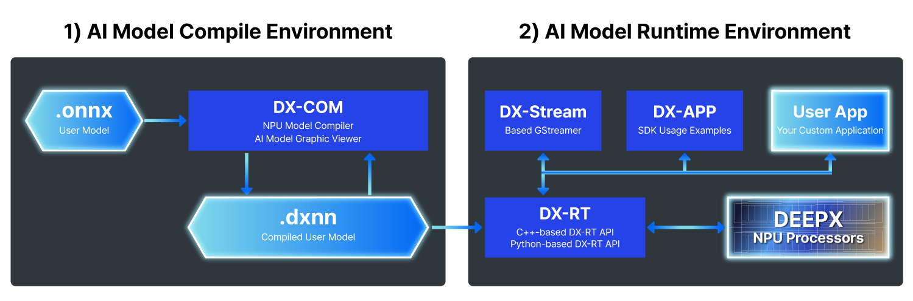

<div align="center">

# DX-APP

**Ready-to-run C++ and Python AI applications for DEEPX NPUs.**

[](https://github.com/DEEPX-AI/dx_app/releases)
[](https://developer.deepx.ai/tech-docs/DXNN-SDK/DX-APP/DXNN_Application_Overview/)

</div>

<div align="center">
  <picture>
    <source media="(prefers-color-scheme: dark)" srcset="./docs/source/img/dxnn_sdk_illustration_simple-dark.png">
    
  </picture>
</div>

DX-APP is the application layer of the DXNN® SDK. It runs `.dxnn` models from
[DX-ModelZoo](https://developer.deepx.ai/modelzoo/) or [DX-COM](https://github.com/DEEPX-AI/dx-compiler) on a
DEEPX NPU through [DX-RT](https://github.com/DEEPX-AI/dx_rt), with input, pre-processing, post-processing and
display already wired up. Use the examples as they are, or as templates for your own application. It is part of
[DX-Runtime](https://github.com/DEEPX-AI/dx-runtime), the target-side bundle of
[DX-AllSuite](https://github.com/DEEPX-AI/dx-all-suite), which keeps the SDK component versions aligned.

- **Examples across many CV tasks** — detection, segmentation, pose, face, depth, oriented boxes, super resolution, retrieval and more, each as a sync and an async example in C++ and Python.
- **C++ post-processing from Python** — `dx_postprocess` (pybind11) runs the same decoding and NMS as the C++ `src/postprocess` library; the `*_cpp_postprocess.py` variants use it.
- **Multi-model graphs** — chain several models in one pipeline from a JSON graph (`multi_model_graph_sync` / `_async`, Python `dx_graph`).
- **Built-in profiling** — every run prints per-stage latency and end-to-end FPS, so you can see whether the CPU or the NPU is the bottleneck.

## What You Need

| | |
|---|---|
| **Arch** | x86_64, aarch64 |
| **OS** | Ubuntu 20.04 / 22.04 / 24.04 / 26.04 LTS, Debian 12 / 13, Windows 10 22H2 or later (x64) |
| **Memory** | 8 GB RAM (16 GB recommended), 4 GB free disk |
| **DX-RT** | v3.5.0 or later, with NPU driver v2.7.0+. Python examples need `dx_engine` 3.5.x |
| **Build tools** | CMake 3.16+, C++14 compiler (GCC 7.5+ or Clang), OpenCV 4.2+ (4.5.5 recommended), Python 3.8–3.14 |
| **Models** | DX-ModelZoo 2_5_0 `.dxnn` files (format v9), which need DX-RT v3.5.0 or later |

## Quick Start

Check that the NPU driver and DX-RT are installed (the first line of `dxcli --version` must be v3.5.0 or later):

```bash
dxcli -s
dxcli --version
```

If they are missing, install them with the [DX-RT](https://github.com/DEEPX-AI/dx_rt) one-line installer and reboot:

```bash
curl -fsSL https://raw.githubusercontent.com/DEEPX-AI/dx-runtime/main/oneline-install.sh | sh
sudo reboot
```

Then build DX-APP and run the interactive demo:

```bash
git clone https://github.com/DEEPX-AI/dx_app.git
cd dx_app
./install.sh --all             # build tools, CMake and OpenCV (needs sudo)
./setup.sh --demo-models       # the models run_demo.sh uses, and the sample videos
./build.sh                     # the demo C++ examples and dx_postprocess
./run_demo.sh                  # pick a task, language and input from menus
```

`run_demo.sh` runs one model per demo task on a sample image or video.

`./build.sh` installs `dx_postprocess` into the `python3` that is first on `PATH`. If `dx_engine` is in a
virtualenv, activate it before you build, or pass `--venv_path <venv>`.

## Run an Example

The default build includes the YOLO11-N object detector. Without `-m` (`--model` in Python), an example uses
its own model and downloads it if it is missing.

```bash
# C++
./bin/yolo11-n_640x640_sync -i sample/img/sample_street.jpg
./bin/yolo11-n_640x640_async -v assets/videos/snowboard.mp4

# Python
python3 src/python_example/object_detection/yolo11/yolo11-n_640x640/yolo11-n_640x640_sync.py \
    --image sample/img/sample_street.jpg
python3 src/python_example/object_detection/yolo11/yolo11-n_640x640/yolo11-n_640x640_async_cpp_postprocess.py \
    --video assets/videos/snowboard.mp4
```

A window shows the results, and the console prints the performance summary. Add `--no-display` on a machine
without a display, and `--save` to write the output under `artifacts/`.

Each model comes in these variants:

| Variant | Post-processing | Best for |
|---|---|---|
| `*_sync` (C++) / `*_sync.py` | C++ / Python | Single images, debugging |
| `*_async` (C++) / `*_async.py` | C++ / Python | Video and streams; overlaps pre-processing, inference and post-processing |
| `*_sync_cpp_postprocess.py` | C++ (`dx_postprocess`) | Python with heavy post-processing |
| `*_async_cpp_postprocess.py` | C++ (`dx_postprocess`) | Highest FPS from Python |

Options and runtime features → [C++ Usage Guide](https://developer.deepx.ai/tech-docs/DXNN-SDK/DX-APP/DX-APP_CPP_Example_Usage_Guide/) · [Python Usage Guide](https://developer.deepx.ai/tech-docs/DXNN-SDK/DX-APP/DX-APP_Python_Example_Usage_Guide/)

## More Models and Examples

The default build covers only the demo models. Build and download the rest as you need them:

```bash
./build.sh --all                                   # every C++ example, plus the multi-model graph CLI
./build.sh --category object_detection             # one task (./build.sh --category list)
./build.sh --target yolov9-s_640x640               # one model, sync and async (./build.sh --target list)

./setup.sh                                         # choose models from a menu
./setup.sh --models yolov9-s_640x640               # by name
./setup.sh --all                                   # every registered model (several GB)
```

Every example folder has a model card (`README.md`) with the model's accuracy, speed and license;
[MODELS.md](./MODELS.md) lists them all by task.

To run several models in one pipeline, build with `--all` and run `bash run_multi_model_demo.sh`;
`--check` validates every shipped graph without an NPU →
[Multi-Model Graph](https://developer.deepx.ai/tech-docs/DXNN-SDK/DX-APP/DX-APP_Multi_Model_Graph/)

To bring your own model → [DX Tool Guide](https://developer.deepx.ai/tech-docs/DXNN-SDK/DX-APP/DX-APP_DX-Tool_Guide/) · [YOLO Customizing Guide](https://developer.deepx.ai/tech-docs/DXNN-SDK/DX-APP/DX-APP_YOLO_Customizing_Guide/)

<details>
<summary><b>Common Command-Line Options</b></summary>

All C++ and Python examples share these options:

| C++ | Python | Description |
|---|---|---|
| `-m` | `--model` | `.dxnn` file (default: the example's own model, downloaded if missing) |
| `-i` / `-v` / `-c` / `-r` | `--image` / `--video` / `--camera` / `--rtsp` | Input source; with none, a sample image for the task is used |
| `-l` | `--loop` | Repeat count |
| `--no-display` | `--no-display` | No preview window |
| `--save`, `--save-dir` | `--save`, `--save-dir` | Save the rendered output (default: under `artifacts/`) |
| `--dump-tensors` | `--dump-tensors` | Dump raw input and output tensors |
| `--config` | `--config` | Model config JSON (score and NMS thresholds) |
| `--show-log` | `--show-log` | Verbose log output |

Environment variables (`DXAPP_VERIFY`, `DXAPP_SAVE_IMAGE`, `DXAPP_PROGRESS`) and other features →
[Architecture and Usage Reference](https://developer.deepx.ai/tech-docs/DXNN-SDK/DX-APP/DX-APP_Project_Overview/)

</details>

<details>
<summary><b>Install on Windows</b></summary>

On Windows 10 22H2 or later (x64), install DX-RT v3.5.0 or later with the DEEPX SDK installer, and Visual Studio
Community 2022 with Desktop development with C++. OpenCV is installed through vcpkg from `vcpkg.json`.

Open the `dx_app` folder in Visual Studio 2022 and select **Build All**, or use `build.bat`, `setup.bat` and
`run_demo.bat` from a terminal.

Details → [Installation and Build](https://developer.deepx.ai/tech-docs/DXNN-SDK/DX-APP/DX-APP_Installation_and_Build/)

</details>

<details>
<summary><b>Cross-Compile, Storage-Constrained Devices</b></summary>

`./build.sh --arch aarch64` cross-compiles the C++ examples into `build_aarch64/`. Build `dx_postprocess` on
the target with `./build.sh` there.

On devices with little storage, such as a Raspberry Pi 5, skip `./setup.sh --all`. `./setup.sh --category <name>`
or `--models` downloads a subset, and `./setup.sh --dry-run` shows what would be downloaded. Every `setup.sh`
download also fetches the sample videos. To skip them, run an example with `--image` without
running `setup.sh`; it downloads its own model if missing.

</details>

## Documentation & Support

- Guides, usage and API reference: **[DX-APP Tech Docs](https://developer.deepx.ai/tech-docs/DXNN-SDK/DX-APP/DXNN_Application_Overview/)** · [Release Notes](./RELEASE_NOTES.md)
- For technical questions, please ask in the DEEPX Developer Community: https://community.deepx.ai/c/support/5

## License

See [LICENSE](./LICENSE) for terms of use.

The sample models (`.dxnn`) and dataset images are for evaluation and development only, not for commercial
deployment. They come from third-party projects and datasets with their own licenses →
[Third-Party License](https://developer.deepx.ai/tech-docs/DXNN-SDK/DX-APP/Appendix_Third_Party_License/)

Copyright © DEEPX Co., Ltd.
