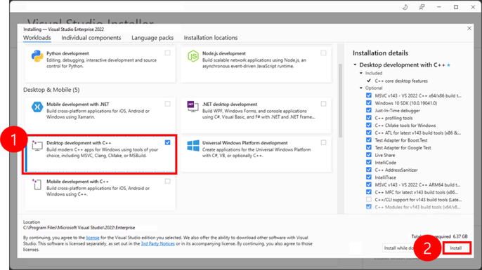
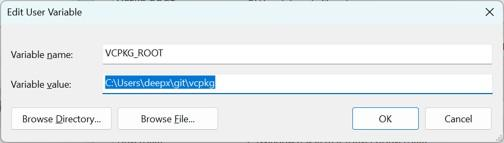
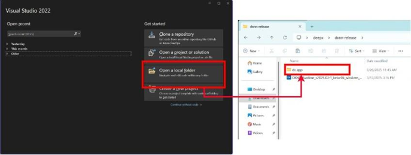
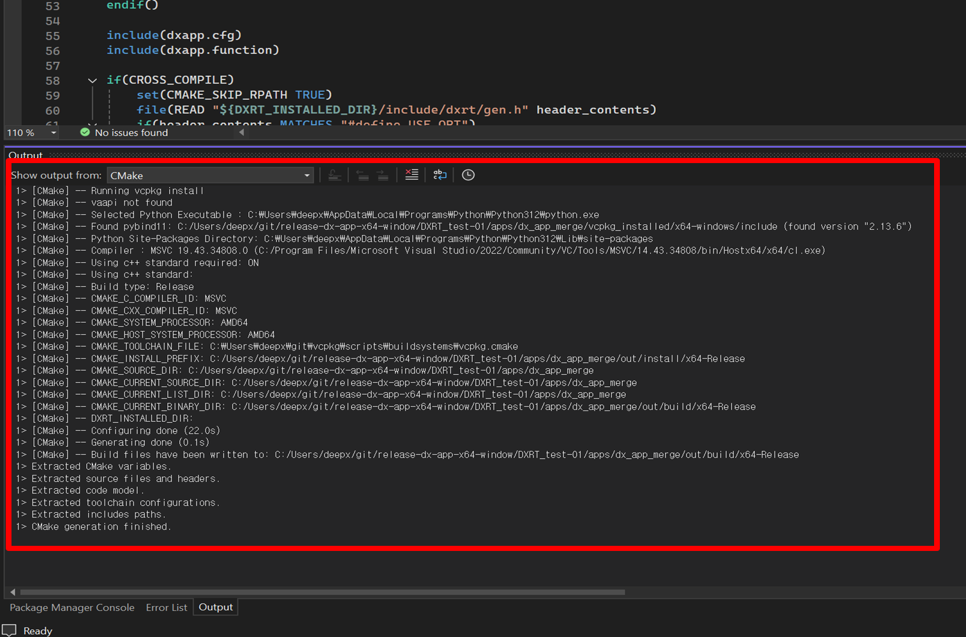
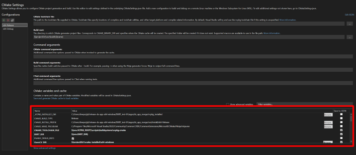
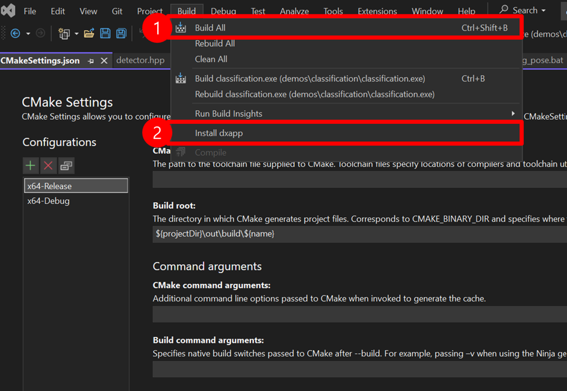

# DX-APP Installation and Build

This guide describes the system requirements and the installation instructions on Linux and Windows to use **DX-APP**.  

---

## Overview & System Requirements 

This section describes the hardware and software requirements for running **DX-APP**.

**Hardware Requirements**

- **CPU:** amd64(x86_64), aarch64(arm64)  
- **RAM:** 8GB RAM (16GB RAM or higher is recommended)  
- **Storage:** 4GB or higher available disk space  

The system **must** support connection to an **M1 M.2** module with the M.2 interface on the host PC.  

!!! note "NOTE" 

    The **NPU Device Driver** and **DX-RT Library must** be installed. Refer to **DX-RT User Manual** for step-by-step installation instructions.  

---

## Installation on Linux

This section describes the software requirements and installation steps for setting up **DX-APP** on Ubuntu-based and Debian-based systems.  

### Software Requirements on Linux  

To run **DX-APP** on Linux, the following components **must** be installed.  

- **OS**: Ubuntu 20.04 / 22.04 / 24.04 (x64) and Debian 12 / 13 (x64)  
- **DEEPX M1 Runtime Lib Version (DX-RT)**: v3.5.0 or higher  
- **NPU Device Driver**: v2.7.0 or higher (RT and PCIe driver). The runtime's own minimum driver, firmware and `.dxnn` versions are printed by `dxrt-cli --version`.  
- **dx_engine** (Python): 3.5.x, matching the runtime's major.minor. `import dx_engine` raises `dx_engine and DX-RT versions do not match` otherwise.  

All required components are included in the **DXNN All Suite (DX-AS)** package.  

!!! note "Why DX-RT 3.5.0"

    `./setup.sh` downloads DX Model Zoo 2_5_0. Those `.dxnn` files are container format **v9**, which DX-RT 3.5.0 is the first runtime to load (DX-RT 3.4.2 refuses them: `Model file format version 9 is not supported`). The C++ examples check the floor when they start and stop with `DXRT library version is too low. (required: >= 3.5.0, current: <version>)`; the check runs after the engine is created, so an older runtime may report its own error on the `.dxnn` first. The Python examples check for DX-RT 3.0.0 or later only. The multi-model graph reads the container version before it creates an engine and names the problem (see the multi_model_graph README, *Model files*).

    Tested with DX-RT 3.5.0, NPU driver 2.7.0 (RT and PCIe), firmware 2.7.4 and `dx_engine` 3.5.0 on a DX-M1 M.2 card (x86_64, Ubuntu 24.04).


### Prerequisites Setup

**Step 1. Install DX-RT Device Driver**  

To set up the build Environment, refer to **Section. Linux Device Driver Installation** in **DX-RT User Manual**.  

Once the DX-RT device driver is installed, the system should include both the PCIe driver and the runtime driver.  You can verify the installation by checking the loaded kernel modules.  

```bash
lsmod | grep dx

# dxrt_driver 53248 2
# dx_dma 475136 7 dxrt_driver
```

**Step 2. Install DX-RT Library**   

To install the DX-RT library and NPU device driver, refer to **Section. Build Guide for Cross-compile** in **DX-RT User Manual**.  

Once **DX-RT** is built, the runtime library and header files are installed in the following directory.  

- Libraries: `/usr/local/lib`  
- Headers: `/usr/local/include`  

```cmake
set(DXRT_INSTALLED_DIR /usr/local)
```

If necessary, you can modify the installation path by editing `cmake/toolchain.x86_64.cmake`.  


### DX-APP Application Setup  

**Step 1. DX-APP Installation Options**  

You can check the available **DX-APP** installation options by running the following command.  

```bash
./install.sh # --help
```

You can view more installation options by entering the `--help` flag.  

**Step 2. OpenCV Installation Options**  

If you want to enable CPU/GPU acceleration, OpenCV **must** be manually installed on your system.  
During the OpenCV build process, setting the following flags is needed.  

- `TBB=ON, IPP=ON, CUDA=ON`  

If OpenCV is already installed, manually set the `OpenCV_DIR` path in your toolchain file.  

```cmake
set(CMAKE_SYSTEM_NAME Linux)
set(CMAKE_SYSTEM_PROCESSOR x86_64)
set(DXRT_INSTALLED_DIR /usr/local)
set(OpenCV_DIR /your/opencv/installation/dir)
set(onnxruntime_LIB_DIRS /usr/local/lib)
```

**Step 3. Build and Run DX-APP**  

To build `dx_app`, run the following command.  

```bash
./build.sh ## Defaults to minimal build (run_demo C++ targets). Use --clean for a clean build.
```

To download required models and sample videos, run the following command.  

```bash
./setup.sh
```

Assets are downloaded and placed in the `assets/` directory.

- **Models:** stored under `assets/models/`
- **Videos:** stored under `assets/videos/`

!!! note "NOTE"
    Running `setup.sh` beforehand is optional. When you run any individual example, missing models are **automatically downloaded** on demand. Videos are also auto-downloaded when a `--video` path is specified but the file does not exist.

!!! note "NOTE"
    The sample models (`.dxnn`) and dataset images are provided for **evaluation and development purposes only** and are not licensed for commercial deployment. For full license details, see [Appendix: Third-Party License Notice](./Appendix_Third_Party_License.md).

**`setup.sh` Options**

| Option | Description |
|--------|-------------|
| `--all` | Download all models non-interactively |
| `--dry-run` | List models that would be downloaded without downloading |
| `--list` | List available models without downloading |
| `--workers=<N>` | Parallel download threads (default: 4) |
| `--category=<name>` | Download models of a specific category only |
| `--models <m1> [m2...]` | Download specific models by name |
| `--no-json` | Skip JSON metadata file downloads |
| `--manifest=<path>` | Use an alternate manifest JSON file |
| `--force` | Force overwrite if files already exist (default) |
| `--no-force` | Skip download if the file already exists |
| `--force-remove-models` | Force remove models if they exist |
| `--force-remove-videos` | Force remove videos if they exist |
| `--verbose` | Show detailed progress output |

For most users, running only `./setup.sh` is sufficient. Contributor-facing setup details are documented separately in the developer guides.

**Post-Processing Unit (PPU) Acceleration Integration**  

DX-APP utilizes PPU Acceleration to maximize inference efficiency on NPU hardware.  

The PPU is engineered to offload computationally intensive post-processing tasks, specifically bounding box decoding and score thresholding, directly to the NPU. This critical architectural shift mitigates the CPU overhead traditionally incurred during post-processing, leading to a substantial enhancement in overall inference throughput.  

**Key Operational Benefits**  

- **Improved Processing Speed:** Achieved by enabling the parallel execution of both the core inference and the post-processing operations.  
- **Enhanced Throughput:** Provides a significant advantage for real-time applications that require sustained high frame rates.  

**PPU-Enabled Models**  

DX-APP registers 14 PPU-accelerated object-detection variants. `SCRFD500M_PPU` and `YOLOV5Pose_PPU` example sources stay on disk and are not registered or built. To run PPU models interactively, use `./run_demo.sh` and select "PPU Pipeline", or use the example runner / DX Model Tool:

```bash
# Interactive — select PPU from the category menu
scripts/run_examples.sh
./scripts/dx_tool.sh run

# Non-interactive
./scripts/dx_tool.sh run --lang cpp --category ppu
```

Available PPU models: YOLOv3-tiny, YOLOv3 (416 and 608), YOLOv4, YOLOv5-S, YOLOv7, YOLOv7-X, YOLOv8-N, YOLOv8-S, YOLOv9-T, YOLOv10-N, YOLO11-N, YOLO12-N, YOLOX-S.

**Step 4. Resolve Shared Library Errors**  

If you encounter shared library errors (e.g., `libdxrt.so`), update the system’s library cache. 

```bash
# Copy your library to /usr/local/lib
sudo cp your_library.so /usr/local/lib

# Update the system's library cache
sudo ldconfig
```

### Downloads behind a TLS-inspecting proxy

**Symptom.** `setup.sh`, or the automatic model download of an example runner, fails behind a corporate proxy that inspects TLS with:

```text
certificate verify failed: Missing Authority Key Identifier
```

**Cause.** Python 3.13 and later (with urllib3 2.3 or later) verify certificates in X.509 strict mode (`VERIFY_X509_STRICT`). Many proxy CAs do not meet it: they lack an Authority Key Identifier, for example. A conda `python3` first on `PATH` is the typical case (Python 3.14 with OpenSSL 3.5). The system Python 3.12 of Ubuntu 24.04, and the dx-runtime virtual environment built from it, are not affected.

**Which Python runs the downloader.** `setup_sample_models.sh` picks the first of these:

1. `DXAPP_SETUP_PYTHON` (a path or a command name; one that is not an executable exits 1);
2. the active virtual environment (`VIRTUAL_ENV`);
3. `../venv-dx-runtime`;
4. `python3`.

The script prints its choice:

```text
[DXAPP] [INFO] Downloader Python: /usr/bin/python3 (Python 3.12.3, OpenSSL 3.0.13 30 Jan 2024)
```

**The ways past it, in the order to try them.**

1. Run the downloader with Python 3.12 or older: activate the dx-runtime virtual environment, or pass `DXAPP_SETUP_PYTHON=<python> ./setup.sh` (for example `/usr/bin/python3` on Ubuntu 24.04).
2. Give the proxy's root CA through `REQUESTS_CA_BUNDLE` (or `CURL_CA_BUNDLE`, `SSL_CERT_FILE`, or the OS trust store). This fixes a *missing* root. It does not change strict mode.
3. Opt in with `DXAPP_TLS_RELAX_X509_STRICT=1 ./setup.sh`. It turns off only `VERIFY_X509_STRICT`. The certificate is still required, the certificate chain and the host name are still verified, and the protocol floor stays TLS 1.2. It covers the connection to the model server, direct or through a tunnel; the TLS connection to an `https://` proxy itself stays strict. The downloader prints a warning while it is on:

```text
[DXAPP] [WARN]  $DXAPP_TLS_RELAX_X509_STRICT=1: X.509 strict mode is off for these downloads; the certificate chain and the host name are still verified
```

Verification is never turned off. After a failure on a strict-mode-only check, the downloader prints this hint (`x509_strict_hint` in `scripts/download_models.py`):

```text
TLS verification failed a strict-mode check (Missing Authority Key Identifier): <python> (Python 3.14.6, OpenSSL 3.5.7 9 Jun 2026) verifies in X.509 strict mode, and the certificate chain presented here - typically a TLS-inspecting proxy's - does not meet it.
Either run the downloader with a Python 3.12 or older: activate a Python 3.12-or-older virtualenv, or DXAPP_SETUP_PYTHON=<python> ./setup.sh (e.g. /usr/bin/python3 on Ubuntu 24.04);
or opt in with DXAPP_TLS_RELAX_X509_STRICT=1 ./setup.sh, which turns off only X.509 strict mode: the certificate chain and the host name are still verified.
```

`python3 scripts/download_models.py --help` documents the variable too.

### Cross-compiling for aarch64

`./build.sh --arch aarch64` configures with `cmake/toolchain.aarch64.cmake` and builds into `build_aarch64/`. A cross build installs into `build_aarch64/release` only. It never writes the repository's `bin/`, `lib/` or `include/`, and `./build.sh --clean` leaves them alone too.

- **dx_graph is skipped.** The Python module would be built against the host's Python, so the configure step says:

  ```text
  dx_graph Python module skipped: cross build (host x86_64, target aarch64): the module would be built against the host's Python. To build it for the target, pass -DDXAPP_CROSS_PYTHON_GRAPH=ON and -DPython_INCLUDE_DIR=<the target Python's include/python3.X> (not validated here: no target Python on the development host)
  ```

  The opt-in is `-DDXAPP_CROSS_PYTHON_GRAPH=ON -DPython_INCLUDE_DIR=<target include/python3.X>`. Both are needed. This path is not covered by the release tests.
- **dx_postprocess skipped.** `pip` would build it for the host and install it into the host's interpreter, so `build.sh` prints `Cross build (aarch64): dx_postprocess skipped - build it on the target with ./build.sh there.` and runs no `pip`.
- **Compile check.** `bash scripts/check_cross_compile.sh` compile-checks the graph engine and the graph CLI for aarch64 (`-fsyntax-only`, C++14, the graph targets' `-Werror` flags). `--with-registry` adds the generated registry sources (about 100 s). It needs `aarch64-linux-gnu-g++` (`DXAPP_CROSS_CXX`), the dxrt headers and the OpenCV headers; it prints `check_cross_compile OK: <n> sources compile for aarch64 (aarch64-linux-gnu-g++, -fsyntax-only)`. Nothing is linked or run on aarch64.
- **Validation scope.** Concurrency (the graph engine's pipelining, `--max-inflight`, default 16) is validated on x86_64 with a DX-M1. aarch64 is compile-checked only.

---

## Installation on Windows  

This section details the software requirements and sequential installation steps necessary for setting up the DX-APP environment on Windows systems.  

- **Stage 1: Prerequisites** - Verify system requirements  
- **Stage 2: Core Runtime** - Install the official DX-RT and M1 Driver  
- **Stage 3: Toolchain** - Install Visual Studio 2022 (C++ compiler/build environment)  
- **Stage 4: Build & Install** - Compile DX-APP source code using build.bat or the VS IDE  


### Software Requirements on Windows  

To run **DX-APP** on Windows, the following components **must** be installed.  

- **OS**: Windows 10 or later  
- **Python**: Version 3.8 or higher (required for Python module support)  
- **Compiler**: Visual Studio Community 2022 (required for building C++ examples)  


### Install DX-RT and M1 Windows Driver  
   
DEEPX provides an official Windows installer for **DXNN Runtime (DX-RT)**, which includes the required runtime libraries and M1 device driver.

**Prerequisite checklist (DX-RT Windows Driver)**  

- Microsoft Visual C++ 2015-2022 Redistributable (x64)  
- DEEPX NPU device (e.g., DX-M1) connected via PCIe slot, M.2 slot, or USB 4.0 (USB4 PCIe tunneling required)  
- Administrator privileges for driver installation  

Visual Studio Community 2022 is the build toolchain (IDE + compiler), while the Microsoft Visual C++ 2015-2022 Redistributable provides the runtime DLLs needed to run the built apps.  

For detailed instructions, refer to [DEEPX NPU Windows Runtime & Driver](https://github.com/DEEPX-AI/dx_rt_windows).  


### Install Visual Studio Community 2022  

To use **DX-APP** on Windows, Visual Studio Community 2022 **must** be installed with appropriate development tools.  

**Installation Step**  

- **Step 1.** Download Visual Studio Community 2022  
- **Step 2.** Launch the installer and select the following workload  
  : Desktop development with C++  
- **Step 3.** (Optional) Select additional workloads or individual components as needed  
- **Step 4.** Click **Install** to begin the installation process  



!!! note "NOTE" 

    Visual Studio Community 2022 is required; other versions are not tested.  


### Install VCPKG  

VCPKG is a C++ package manager used for handling third-party dependencies like OpenCV.  

!!! note "NOTE" 

    If you are using Visual Studio Community 2022, **VCPKG is pre-installed**, so no separate installation is necessary. 

If manual installation is required, follow the steps below.  

- **Step 1.** Download the vcpkg package from GitHub  
- **Step 2.** Open **Command Prompt** and Run the following command  
- **Step 3.** Set the user variables  
    : Variable Name: `VCPKG_ROOT`  
    : Variable Value: Path to your vcpkg installation directory  

!!! note "NOTE" 

    This step is essential to allow Visual Studio to automatically detect and use VCPKG-managed packages like OpenCV.  




### Build and Install dx_app in Visual Studio Community 2022  

To build and run the `dx_app` application on Windows, follow the steps below using Visual Studio Community 2022.  

**Step 1. Open Project Folder**  

- **Step 1-1.** Launch Visual Studio Community 2022  
- **Step 1-2.** From the start screen, select **Open a local folder**  
- **Step 1-3.** Navigate to and select the `dx_app` project folder  

!!! warning "IMPORTANT" 

    You **must** use Visual Studio 2022. Support for other versions (VS 2019, VS Code, etc.) has not been tested and compatibility cannot be guaranteed.   



**Step 2. Project Configuration**  

Upon opening the project,  

- Dependencies specified in `vcpkg.json` will be automatically downloaded and installed into the `vcpkg_installed` directory.  
- CMake will automatically generate the build cache and configuration.  



**Step 3. (Optional) Edit CMakeSettings**  

If needed, you can manually specify the following environment variables in `CMakeSettings.json`.  

- `DEEPX_SDK_DIR`: Path to the installed DEEPX SDK (DX-RT runtime)  
- `OpenCV_DIR`: Path to the OpenCV installation (if manually installed)  

```json
{
    "name": "CMAKE_TOOLCHAIN_FILE",
    "value": "${env.VCPKG_ROOT}/scripts/buildsystems/vcpkg.cmake",
    "type": "STRING"
},
{
    "name": "DEEPX_SDK_DIR",
    "value": "path/to/dx_rt/installed",
    "type": "STRING"
},
{
    "name": "OpenCV_DIR",
    "value": "${projectDir}/vcpkg_installed/x64-windows/share/opencv",
    "type": "STRING"
}
```

**Step 4. Register `PATH` Variable**  

Ensure the required runtime libraries are accessible with the system’s `PATH` environment variable.  

- `DEEPX_SDK_DIR` is referenced in CMAKE as `${env.DEEPX_SDK_DIR}`.  

!!! note "NOTE"  

    If you are using `dx_app/vcpkg.json`, OpenCV will be automatically downloaded and installed into `vcpkg_installed/x64-windows` directory during CMake configuration step. 




**Step 5. Build and Install `dx_app`**  

To build and install the dx_app application  

- **Step 5-1.** Go to the **Build** menu  
- **Step 5-2.** Click **Build All** (or **Rebuild All**) to begin the build process  

Upon successful compilation, the application executable will be generated under the `bin/` directory.  




### Alternative Build Method: Using build.bat

The updated `build.bat` now generates `build_internal.bat` from `CMakeSettings.json` and drives both the DX-APP build and the pybind C++ module build.  

**Key behaviors**  

- Generates `build_internal.bat` based on the selected CMake configuration (toolchain, paths, generator).  
- Validates environment (e.g., `DEEPX_SDK_DIR`) and cleans stale CMake cache to avoid generator/toolset mismatches.  
- Builds and installs DX-APP executables/libraries, then builds the pybind C++ module.  

**Prerequisites**  

- `DEEPX_SDK_DIR` set to the DEEPX SDK installation directory  
- Visual Studio 2022 with Desktop development with C++ workload  
- CMake available in `PATH`  

**Usage**  

From the project root  
```batch
build.bat
```

`build_internal.bat` is written alongside, then executed to configure, build, and install outputs. Use the generated `dxapp.sln` (under the build directory, `./out/build/x64-Release/`) if you want to open in Visual Studio 2022 for further development.  

**Visual Studio solution Generation**  

After successful execution of build.bat, the script generates the necessary solution files for development within the IDE.  

- **[Important] Open Solution:** Open the generated solution file at `out\build\x64-Release\dxapp.sln`  **using Visual Studio 2022**  
     **NOTE.** Opening with other versions may cause compatibility issues or build failures.  
- **Access & Customization**: Use Visual Studio 2022 for debugging, development, and further customization. All project targets and configurations are accessible through the VS 2022 interface.  

**Build Output Structure**  

```text
dx_app/
├── out/                   # Build directory created by build.bat
│   ├── build/             # CMake build files
│   │   ├── x64-Release/   # Release build configuration
│   │   │   ├── dxapp.sln  # Visual Studio 2022 solution file
│   │   │   ├── *.vcxproj  # Project files for each target
│   │   │   └── ...        # Other build artifacts
│   │   └── ...
│   └── install/           # Installation directory
├── bin/                   # Installed executables
└── lib/                   # Installed libraries
```

### Graph engine on Windows

The graph engine, the `multi_model_graph_{sync,async}` CLI and the generated model registry are **not built or tested on Windows in this release**. The Windows support below is prepared and verified on Linux only:

- **MSVC stays C++17.** Under `/std:c++14` the tree's own filesystem switch picks `<experimental/filesystem>`, which current MSVC STL rejects, and the Windows build has only ever been C++17. C++14 is enforced where it can be checked: GCC/Clang `-Werror=c++17-extensions` and `scripts/check_cross_compile.sh`.
- **Graph targets get `/bigobj` and two warnings as errors.** `/bigobj` (a generated registry source holds up to 64 factories), `/w15038 /we5038` (C5038, members initialized out of order) and, for targets with a `switch` over an enum, `/w14062 /we4062` (C4062, an enumerator not handled). Tests check that the flags are emitted, not that MSVC accepts them.
- **Python 3 is needed to configure.** The configure step runs `scripts/gen_model_registry.py`. Without a Python 3 it stops with `No Python 3 interpreter for the graph model registry` and names the fix: install Python 3 (the Microsoft Store stub does not work) or pass `-DPython3_EXECUTABLE=<path to python3>`.
- **Ctrl-C** goes through `SetConsoleCtrlHandler`: the first press asks for a graceful stop, a repeat within 200 ms counts as the same request, a later press ends the process with `STATUS_CONTROL_C_EXIT`. **Ctrl-Break** ends it at once, as before. It is tested on Linux against a stub `<windows.h>`.
- **Tests find the binaries** in `bin\Release` (or `bin\RelWithDebInfo`, `bin\Debug`), else `bin\`, with `.exe` names.
- **Smoke tests.** `tests\windows\run_tests.bat graph` runs the graph CLI smoke tests (`--help`, `--list-models`, `--check`; no NPU).
- **dx_graph has no Windows build.** The CMake decision function skips it for MSVC.

### Run Example Executable Files On Windows  

After building and installing dx_app, you can execute the demo applications using provided batch scripts.  

**Step 1. Execute `setup.bat`**  

Run the `setup.bat` script to automatically download all required models and sample videos.  

- The downloaded assets will be placed in the `assets` folder.  
- The assets include models for Classification, Object Detection, and Segmentation.  

**Step 2. Run Examples**  

You can run the examples using the same command line instructions as in Linux, but using the `.exe` extension for executables.  

classification example  
```shell
./bin/efficientnet-lite0_224x224_async.exe -m ./assets/models/efficientnet-lite0_224x224.dxnn -i ./sample/ILSVRC2012/0.jpeg 
```

object detection example  
```shell
./bin/yolov8-n_640x640_sync.exe  -m ./assets/models/yolov8-n_640x640.dxnn -i ./sample/img/sample_kitchen.jpg -l 10
```

---
