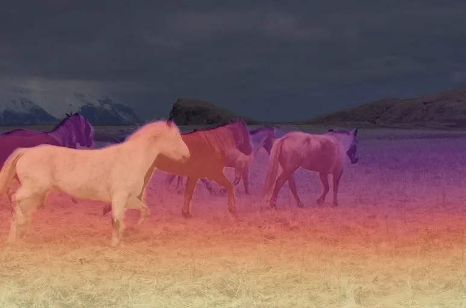

<!-- Generated by DX AI Studio (python -m dx_modelzoo.tools.export_dx_app_cards). Do not edit by hand. -->

# Depth-Anything-V2-ViT-B

Depth Estimation · `depthanythingv2-vitb_224x224` · DX-APP C++ example

Depth Estimation model, evaluated on NYUDepthv2.

**Input** 224 × 224 × 3 · **Dataset** NYUDepthv2 · **License** CC BY-NC 4.0 · **Quantization** Q-Lite, Q-Pro



Full card with copy buttons and dark/light theme (open it in a browser; GitHub shows its source): [model.html](../../../../python_example/depth_estimation/depthanythingv2/depthanythingv2-vitb_224x224/model.html)

## Quick start

Run from the dx_app root after `./install.sh` and `./build.sh`.

```bash
# from the dx_app root
./setup_sample_models.sh --models depth_anything_v2_vitb-1
```

**C++**

```bash
./build.sh --target depthanythingv2-vitb_224x224_sync   # once
./bin/depthanythingv2-vitb_224x224_sync \
  -m assets/models/depthanythingv2-vitb_224x224.dxnn \
  -i sample/img/sample_parking.jpg
```

**Python**

```bash
python src/python_example/depth_estimation/depthanythingv2/depthanythingv2-vitb_224x224/depthanythingv2-vitb_224x224_sync.py \
  --model assets/models/depthanythingv2-vitb_224x224.dxnn \
  --image sample/img/sample_parking.jpg
```

## Accuracy

| Quantization | RMSE |
|---|---:|
| Raw · ONNX | 0.50 |
| Q-Lite | 0.50 (±0.00) |
| Q-Pro | 0.50 (±0.00) |

NYUDepthv2 · difference vs Raw in brackets.

## Model

| | |
|---|---|
| Task | Depth Estimation |
| Dataset | NYUDepthv2 |
| Metric | RMSE |
| Input | 224 × 224 × 3 |
| Parameters | 97.17 M |
| Operations | 31.59 GOPs |
| Family | depthanythingv2 |

## Downloads

| Artifact | Compiler | Files |
|---|---|---|
| ONNX | — | [ONNX](https://sdk.deepx.ai/modelzoo/onnx/depthanythingv2-vitb_224x224.onnx) |
| Q-Lite | DX-COM 2.5.0 | [DXNN](https://sdk.deepx.ai/modelzoo/q-lite-dxnn/2_5_0/depthanythingv2-vitb_224x224.dxnn) · [JSON](https://sdk.deepx.ai/modelzoo/q-lite-json/2_5_0/depthanythingv2-vitb_224x224.json) |
| Q-Pro | DX-COM 2.4.0 | [DXNN](https://sdk.deepx.ai/modelzoo/q-pro-dxnn/2_4_0/depthanythingv2-vitb_224x224.dxnn) |

## Files in this example

| File | What it is |
|---|---|
| `depthanythingv2-vitb_224x224_sync.cpp` | C++ · one image, video or camera |
| `depthanythingv2-vitb_224x224_async.cpp` | C++ · pipelined, higher throughput |
| `config.json` | Thresholds, input size, default sample |
| `factory/` | Pre-, post-processor and visualizer |

[Python version of this example](../../../../python_example/depth_estimation/depthanythingv2/depthanythingv2-vitb_224x224/)

## Source & License

[DepthAnything/Depth-Anything-V2](https://github.com/DepthAnything/Depth-Anything-V2) — CC BY-NC 4.0 (Creative Commons Attribution-NonCommercial 4.0 — https://creativecommons.org/licenses/by-nc/4.0/) · © DepthAnything. Check the upstream license before commercial use.

Compile it yourself: DX-COM in dx-compiler, or DX AI Studio → Compiler.

---

<sub>Generated from the DX Model Zoo publish table (as of 2026-10-13). Open this model in DX AI Studio → Model Zoo for live inference and the model graph.</sub>
