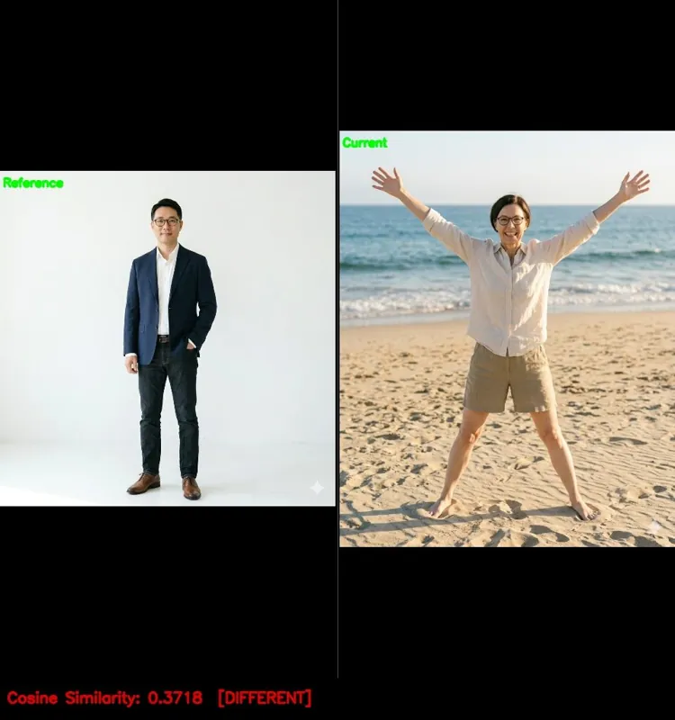

<!-- Generated by DX AI Studio (python -m dx_modelzoo.tools.export_dx_app_cards). Do not edit by hand. -->

# CAS-ViT-M

Classification · `casvit-m_224x224` · DX-APP C++ example

Classification model, evaluated on ImageNet.

**Input** 224 × 224 × 3 · **Dataset** ImageNet · **License** MIT · **Quantization** Q-Lite, Q-Pro



Full card with copy buttons and dark/light theme (open it in a browser; GitHub shows its source): [model.html](../../../../python_example/image_classification/casvit/casvit-m_224x224/model.html)

## Quick start

Run from the dx_app root after `./install.sh` and `./build.sh`.

```bash
# from the dx_app root
./setup_sample_models.sh --models casvit_m
```

**C++**

```bash
./build.sh --target casvit-m_224x224_sync   # once
./bin/casvit-m_224x224_sync \
  -m assets/models/casvit-m_224x224.dxnn \
  -i sample/img/person_pair
```

**Python**

```bash
python src/python_example/image_classification/casvit/casvit-m_224x224/casvit-m_224x224_sync.py \
  --model assets/models/casvit-m_224x224.dxnn \
  --image sample/img/person_pair
```

## Accuracy

| Quantization | Top1 |
|---|---:|
| Raw · ONNX | 81.40 |
| Q-Lite | 80.73 (−0.67) |
| Q-Pro | 81.28 (−0.12) |

ImageNet · difference vs Raw in brackets.

## Model

| | |
|---|---|
| Task | Classification |
| Dataset | ImageNet |
| Metric | Top1 |
| Input | 224 × 224 × 3 |
| Parameters | 12.42 M |
| Operations | 1.89 GOPs |
| Family | casvit |

## Downloads

| Artifact | Compiler | Files |
|---|---|---|
| ONNX | — | [ONNX](https://sdk.deepx.ai/modelzoo/onnx/casvit-m_224x224.onnx) |
| Q-Lite | DX-COM 2.5.0 | [DXNN](https://sdk.deepx.ai/modelzoo/q-lite-dxnn/2_5_0/casvit-m_224x224.dxnn) · [JSON](https://sdk.deepx.ai/modelzoo/q-lite-json/2_5_0/casvit-m_224x224.json) |
| Q-Pro | DX-COM 2.4.0 | [DXNN](https://sdk.deepx.ai/modelzoo/q-pro-dxnn/2_4_0/casvit-m_224x224.dxnn) |

## Files in this example

| File | What it is |
|---|---|
| `casvit-m_224x224_sync.cpp` | C++ · one image, video or camera |
| `casvit-m_224x224_async.cpp` | C++ · pipelined, higher throughput |
| `config.json` | Thresholds, input size, default sample |
| `factory/` | Pre-, post-processor and visualizer |

[Python version of this example](../../../../python_example/image_classification/casvit/casvit-m_224x224/)

## Source & License

[Tianfang-Zhang/CAS-ViT](https://github.com/Tianfang-Zhang/CAS-ViT) — MIT (MIT License — https://opensource.org/license/mit) · © Tianfang Zhang. Check the upstream license before commercial use.

Compile it yourself: DX-COM in dx-compiler, or DX AI Studio → Compiler.

---

<sub>Generated from the DX Model Zoo publish table (as of 2026-10-13). Open this model in DX AI Studio → Model Zoo for live inference and the model graph.</sub>
