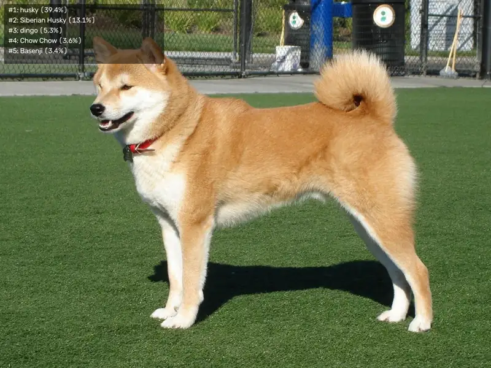

<!-- Generated by DX AI Studio (python -m dx_modelzoo.tools.export_dx_app_cards). Do not edit by hand. -->

# ResNeXt-50 (32x4d, imgclsmob)

Classification · `resnext50-32x4d_224x224_imgclsmob` · DX-APP C++ example

Classification model, evaluated on ILSVRC2012.

**Input** 224 × 224 · **Dataset** ILSVRC2012 · **License** MIT · **Quantization** Q-Lite, Q-Pro



Full card with copy buttons and dark/light theme (open it in a browser; GitHub shows its source): [model.html](../../../../python_example/image_classification/resnext/resnext50-32x4d_224x224_imgclsmob/model.html)

## Quick start

Run from the dx_app root after `./install.sh` and `./build.sh`.

```bash
# from the dx_app root
./setup_sample_models.sh --models resnext50_32x4d_imgclsmob
```

**C++**

```bash
./build.sh --target resnext50-32x4d_224x224_imgclsmob_sync   # once
./bin/resnext50-32x4d_224x224_imgclsmob_sync \
  -m assets/models/resnext50-32x4d_224x224_imgclsmob.dxnn \
  -i sample/img/sample_dog.jpg
```

**Python**

```bash
python src/python_example/image_classification/resnext/resnext50-32x4d_224x224_imgclsmob/resnext50-32x4d_224x224_imgclsmob_sync.py \
  --model assets/models/resnext50-32x4d_224x224_imgclsmob.dxnn \
  --image sample/img/sample_dog.jpg
```

## Accuracy

| Quantization | Top1 |
|---|---:|
| Raw · ONNX | 78.88 |
| Q-Lite | 78.52 (−0.36) |
| Q-Pro | 78.72 (−0.16) |

ILSVRC2012 · difference vs Raw in brackets.

## Model

| | |
|---|---|
| Task | Classification |
| Dataset | ILSVRC2012 |
| Metric | Top1 |
| Input | 224 × 224 |
| Family | resnext |

## Downloads

| Artifact | Compiler | Files |
|---|---|---|
| ONNX | — | [ONNX](https://sdk.deepx.ai/modelzoo/onnx/resnext50-32x4d_224x224_imgclsmob.onnx) |
| Q-Lite | DX-COM 2.5.0 | [DXNN](https://sdk.deepx.ai/modelzoo/q-lite-dxnn/2_5_0/resnext50-32x4d_224x224_imgclsmob.dxnn) · [JSON](https://sdk.deepx.ai/modelzoo/q-lite-json/2_5_0/resnext50-32x4d_224x224_imgclsmob.json) |
| Q-Pro | DX-COM 2.4.0 | [DXNN](https://sdk.deepx.ai/modelzoo/q-pro-dxnn/2_4_0/resnext50-32x4d_224x224_imgclsmob.dxnn) |

## Files in this example

| File | What it is |
|---|---|
| `resnext50-32x4d_224x224_imgclsmob_sync.cpp` | C++ · one image, video or camera |
| `resnext50-32x4d_224x224_imgclsmob_async.cpp` | C++ · pipelined, higher throughput |
| `config.json` | Thresholds, input size, default sample |
| `factory/` | Pre-, post-processor and visualizer |

[Python version of this example](../../../../python_example/image_classification/resnext/resnext50-32x4d_224x224_imgclsmob/)

## Source & License

[osmr/imgclsmob](https://github.com/osmr/imgclsmob) — MIT (MIT License — https://opensource.org/license/mit) · © osmr. Check the upstream license before commercial use.

Compile it yourself: DX-COM in dx-compiler, or DX AI Studio → Compiler.

---

<sub>Generated from the DX Model Zoo publish table (as of 2026-10-13). Open this model in DX AI Studio → Model Zoo for live inference and the model graph.</sub>
