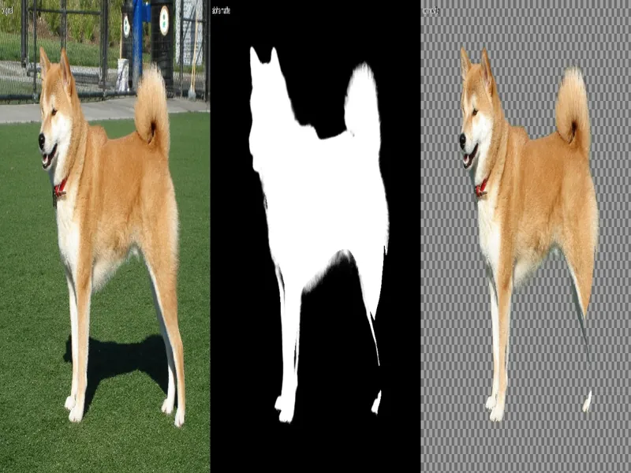

<!-- Generated by DX AI Studio (python -m dx_modelzoo.tools.export_dx_app_cards). Do not edit by hand. -->

# ppmatting-hrnet_w48-distinctions

Image Matting · `ppmatting-hrnet-w48-distinctions_512x512` · DX-APP C++ example

Image Matting model, evaluated on Distinctions646.

**Input** 512 × 512 × 3 · **Dataset** Distinctions646 · **License** Apache-2.0 · **Quantization** Q-Lite



Full card with copy buttons and dark/light theme (open it in a browser; GitHub shows its source): [model.html](../../../../python_example/image_matting/ppmatting/ppmatting-hrnet-w48-distinctions_512x512/model.html)

## Quick start

Run from the dx_app root after `./install.sh` and `./build.sh`.

```bash
# from the dx_app root
./setup_sample_models.sh --models ppmatting_hrnet_w48_distinctions_512x512
```

**C++**

```bash
./build.sh --target ppmatting-hrnet-w48-distinctions_512x512_sync   # once
./bin/ppmatting-hrnet-w48-distinctions_512x512_sync \
  -m assets/models/ppmatting-hrnet-w48-distinctions_512x512.dxnn \
  -i sample/img/sample_dog.jpg
```

**Python**

```bash
python src/python_example/image_matting/ppmatting/ppmatting-hrnet-w48-distinctions_512x512/ppmatting-hrnet-w48-distinctions_512x512_sync.py \
  --model assets/models/ppmatting-hrnet-w48-distinctions_512x512.dxnn \
  --image sample/img/sample_dog.jpg
```

## Accuracy

| Quantization | SAD |
|---|---:|
| Q-Lite | 79.76 |

## Model

| | |
|---|---|
| Task | Image Matting |
| Dataset | Distinctions646 |
| Metric | SAD |
| Input | 512 × 512 × 3 |
| Parameters | 85.85 M |
| Operations | 173.81 GOPs |
| Family | ppmatting |

## Downloads

| Artifact | Compiler | Files |
|---|---|---|
| ONNX | — | [ONNX](https://sdk.deepx.ai/modelzoo/onnx/ppmatting-hrnet-w48-distinctions_512x512.onnx) |
| Q-Lite | DX-COM 2.5.0 | [DXNN](https://sdk.deepx.ai/modelzoo/q-lite-dxnn/2_5_0/ppmatting-hrnet-w48-distinctions_512x512.dxnn) · [JSON](https://sdk.deepx.ai/modelzoo/q-lite-json/2_5_0/ppmatting-hrnet-w48-distinctions_512x512.json) |

## Files in this example

| File | What it is |
|---|---|
| `ppmatting-hrnet-w48-distinctions_512x512_sync.cpp` | C++ · one image, video or camera |
| `ppmatting-hrnet-w48-distinctions_512x512_async.cpp` | C++ · pipelined, higher throughput |
| `config.json` | Thresholds, input size, default sample |
| `factory/` | Pre-, post-processor and visualizer |

[Python version of this example](../../../../python_example/image_matting/ppmatting/ppmatting-hrnet-w48-distinctions_512x512/)

## Source & License

[PaddlePaddle/PaddleSeg/blob/release/2.8/Matting/configs/ppmatting/ppmatting-hrnet_w48-distinctions.yml](https://github.com/PaddlePaddle/PaddleSeg/blob/release/2.8/Matting/configs/ppmatting/ppmatting-hrnet_w48-distinctions.yml) — Apache-2.0 (Apache License 2.0 — https://www.apache.org/licenses/LICENSE-2.0) · © PaddlePaddle. Check the upstream license before commercial use.

Compile it yourself: DX-COM in dx-compiler, or DX AI Studio → Compiler.

---

<sub>Generated from the DX Model Zoo publish table (as of 2026-10-13). Open this model in DX AI Studio → Model Zoo for live inference and the model graph.</sub>
