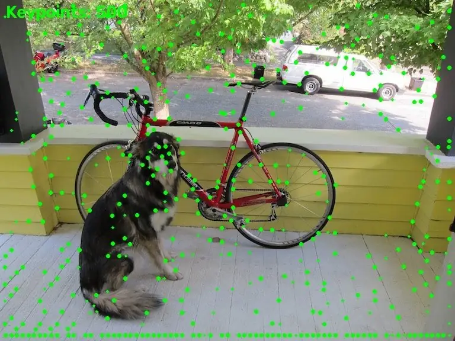

<!-- Generated by DX AI Studio (python -m dx_modelzoo.tools.export_dx_app_cards). Do not edit by hand. -->

# SuperPoint

Keypoint Detection · `superpoint_480x640` · DX-APP C++ example

Keypoint Detection model, evaluated on HPatches.

**Input** 480 × 640 × 3 · **Dataset** HPatches · **License** Non-commercial · **Quantization** Q-Lite, Q-Pro



Full card with copy buttons and dark/light theme (open it in a browser; GitHub shows its source): [model.html](../../../../python_example/keypoint_detection/superpoint/superpoint_480x640/model.html)

## Quick start

Run from the dx_app root after `./install.sh` and `./build.sh`.

```bash
# from the dx_app root
./setup_sample_models.sh --models superpoint-1
```

**C++**

```bash
./build.sh --target superpoint_480x640_sync   # once
./bin/superpoint_480x640_sync \
  -m assets/models/superpoint_480x640.dxnn \
  -i sample/img/sample_street.jpg
```

**Python**

```bash
python src/python_example/keypoint_detection/superpoint/superpoint_480x640/superpoint_480x640_sync.py \
  --model assets/models/superpoint_480x640.dxnn \
  --image sample/img/sample_street.jpg
```

## Accuracy

| Quantization | HEA | M.Score |
|---|---:|---:|
| Raw · ONNX | 73.97 | 43.60 |
| Q-Lite | 73.45 (−0.52) | 42.03 (−1.57) |
| Q-Pro | 74.14 (+0.17) | 43.47 (−0.13) |

HPatches · difference vs Raw in brackets.

## Model

| | |
|---|---|
| Task | Keypoint Detection |
| Dataset | HPatches |
| Metric | HEA · M.Score |
| Input | 480 × 640 × 3 |
| Parameters | 1.30 M |
| Operations | 26.20 GOPs |
| Family | superpoint |

## Downloads

| Artifact | Compiler | Files |
|---|---|---|
| ONNX | — | [ONNX](https://sdk.deepx.ai/modelzoo/onnx/superpoint_480x640.onnx) |
| Q-Lite | DX-COM 2.5.0 | [DXNN](https://sdk.deepx.ai/modelzoo/q-lite-dxnn/2_5_0/superpoint_480x640.dxnn) · [JSON](https://sdk.deepx.ai/modelzoo/q-lite-json/2_5_0/superpoint_480x640.json) |
| Q-Pro | DX-COM 2.4.0 | [DXNN](https://sdk.deepx.ai/modelzoo/q-pro-dxnn/2_4_0/superpoint_480x640.dxnn) |

## Files in this example

| File | What it is |
|---|---|
| `superpoint_480x640_sync.cpp` | C++ · one image, video or camera |
| `superpoint_480x640_async.cpp` | C++ · pipelined, higher throughput |
| `config.json` | Thresholds, input size, default sample |
| `factory/` | Pre-, post-processor and visualizer |

[Python version of this example](../../../../python_example/keypoint_detection/superpoint/superpoint_480x640/)

## Source & License

[magicleap/SuperPointPretrainedNetwork](https://github.com/magicleap/SuperPointPretrainedNetwork) — Non-commercial (Non-commercial use only — see the source repository for terms) · © magicleap. Check the upstream license before commercial use.

Compile it yourself: DX-COM in dx-compiler, or DX AI Studio → Compiler.

---

<sub>Generated from the DX Model Zoo publish table (as of 2026-10-13). Open this model in DX AI Studio → Model Zoo for live inference and the model graph.</sub>
