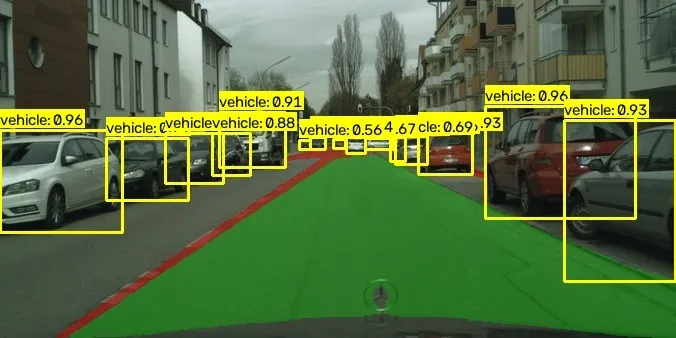

<!-- Generated by DX AI Studio (python -m dx_modelzoo.tools.export_dx_app_cards). Do not edit by hand. -->

# YOLOPv2

Panoptic Driving Perception · `yolopv2_384x640` · DX-APP C++ example

Panoptic Driving Perception model, evaluated on BDD100K.

**Input** 384 × 640 × 3 · **Dataset** BDD100K · **License** MIT · **Quantization** Q-Lite, Q-Pro



Full card with copy buttons and dark/light theme (open it in a browser; GitHub shows its source): [model.html](../../../../python_example/panoptic_driving_perception/yolopv2/yolopv2_384x640/model.html)

## Quick start

Run from the dx_app root after `./install.sh` and `./build.sh`.

```bash
# from the dx_app root
./setup_sample_models.sh --models yolopv2-1
```

**C++**

```bash
./build.sh --target yolopv2_384x640_sync   # once
./bin/yolopv2_384x640_sync \
  -m assets/models/yolopv2_384x640.dxnn \
  -i sample/img/sample_parking.jpg
```

**Python**

```bash
python src/python_example/panoptic_driving_perception/yolopv2/yolopv2_384x640/yolopv2_384x640_sync.py \
  --model assets/models/yolopv2_384x640.dxnn \
  --image sample/img/sample_parking.jpg
```

## Accuracy

| Quantization | det_mAP50 |
|---|---:|
| Raw · ONNX | 84.87 |
| Q-Lite | 84.73 (−0.14) |
| Q-Pro | 84.83 (−0.04) |

BDD100K · difference vs Raw in brackets.

## Model

| | |
|---|---|
| Task | Panoptic Driving Perception |
| Dataset | BDD100K |
| Metric | det_mAP50 |
| Input | 384 × 640 × 3 |
| Parameters | 38.96 M |
| Operations | 39.78 GOPs |
| Family | yolopv2 |

## Downloads

| Artifact | Compiler | Files |
|---|---|---|
| ONNX | — | [ONNX](https://sdk.deepx.ai/modelzoo/onnx/yolopv2_384x640.onnx) |
| Q-Lite | DX-COM 2.5.0 | [DXNN](https://sdk.deepx.ai/modelzoo/q-lite-dxnn/2_5_0/yolopv2_384x640.dxnn) · [JSON](https://sdk.deepx.ai/modelzoo/q-lite-json/2_5_0/yolopv2_384x640.json) |
| Q-Pro | DX-COM 2.4.0 | [DXNN](https://sdk.deepx.ai/modelzoo/q-pro-dxnn/2_4_0/yolopv2_384x640.dxnn) |

## Files in this example

| File | What it is |
|---|---|
| `yolopv2_384x640_sync.cpp` | C++ · one image, video or camera |
| `yolopv2_384x640_async.cpp` | C++ · pipelined, higher throughput |
| `config.json` | Thresholds, input size, default sample |
| `factory/` | Pre-, post-processor and visualizer |

[Python version of this example](../../../../python_example/panoptic_driving_perception/yolopv2/yolopv2_384x640/)

## Source & License

[hustvl/YOLOP](https://github.com/hustvl/YOLOP) — MIT (MIT License — https://opensource.org/license/mit) · © hustvl. Check the upstream license before commercial use.

Compile it yourself: DX-COM in dx-compiler, or DX AI Studio → Compiler.

---

<sub>Generated from the DX Model Zoo publish table (as of 2026-10-13). Open this model in DX AI Studio → Model Zoo for live inference and the model graph.</sub>
