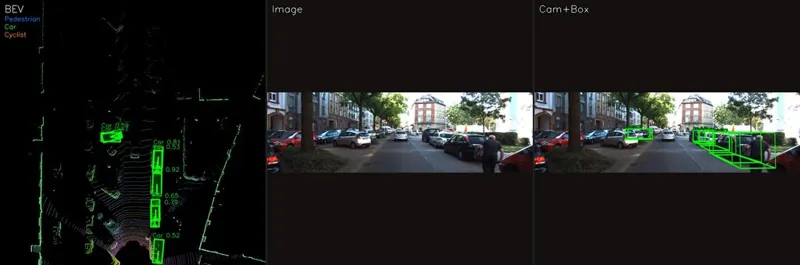

<!-- Generated by DX AI Studio (python -m dx_modelzoo.tools.export_dx_app_cards). Do not edit by hand. -->

# SFA3D

3D Object Detection · `sfa3d_608x608` · DX-APP Python example

3D Object Detection model, evaluated on KITTI.

**Input** 608 × 608 × 3 · **Dataset** KITTI · **License** MIT · **Quantization** Q-Lite



Full card with copy buttons and dark/light theme (open it in a browser; GitHub shows its source): [model.html](model.html)

## Quick start

Run from the dx_app root after `./install.sh` and `./build.sh`.

```bash
# from the dx_app root
./setup_sample_models.sh --models sfa3d_608x608
```

**Python**

```bash
python src/python_example/3d_object_detection/sfa3d/sfa3d_608x608/sfa3d_608x608_sync.py \
  --model assets/models/sfa3d_608x608.dxnn \
  --image sample/kitti/velodyne/000049.bin
```

**C++**

```bash
./build.sh --target sfa3d_608x608_sync   # once
./bin/sfa3d_608x608_sync \
  -m assets/models/sfa3d_608x608.dxnn \
  -i sample/kitti/velodyne/000049.bin
```

## Accuracy

| Quantization | mAP_BEV@0.5 |
|---|---:|
| Raw · ONNX | 93.76 |
| Q-Lite | 91.21 (−2.55) |

KITTI · difference vs Raw in brackets.

## Model

| | |
|---|---|
| Task | 3D Object Detection |
| Dataset | KITTI |
| Metric | mAP_BEV@0.5 |
| Input | 608 × 608 × 3 |
| Parameters | 12.74 M |
| Operations | 31.97 GOPs |
| Family | sfa3d |

## Downloads

| Artifact | Compiler | Files |
|---|---|---|
| ONNX | — | [ONNX](https://sdk.deepx.ai/modelzoo/onnx/sfa3d_608x608.onnx) |
| Q-Lite | DX-COM 2.5.0 | [DXNN](https://sdk.deepx.ai/modelzoo/q-lite-dxnn/2_5_0/sfa3d_608x608.dxnn) · [JSON](https://sdk.deepx.ai/modelzoo/q-lite-json/2_5_0/sfa3d_608x608.json) |

## Files in this example

| File | What it is |
|---|---|
| `sfa3d_608x608_sync.py` | Python · one image, video or camera |
| `sfa3d_608x608_async.py` | Python · pipelined, higher throughput |
| `sfa3d_608x608_sync_cpp_postprocess.py` | Python with the C++ postprocess binding |
| `sfa3d_608x608_async_cpp_postprocess.py` | Python async with the C++ postprocess binding |
| `config.json` | Thresholds, input size, default sample |
| `factory/` | Pre-, post-processor and visualizer |

[C++ version of this example](../../../../cpp_example/3d_object_detection/sfa3d/sfa3d_608x608/)

## Source & License

[maudzung/SFA3D](https://github.com/maudzung/SFA3D) — MIT (MIT License — https://opensource.org/license/mit) · © maudzung. Check the upstream license before commercial use.

Compile it yourself: DX-COM in dx-compiler, or DX AI Studio → Compiler.

---

<sub>Generated from the DX Model Zoo publish table (as of 2026-10-13). Open this model in DX AI Studio → Model Zoo for live inference and the model graph.</sub>
