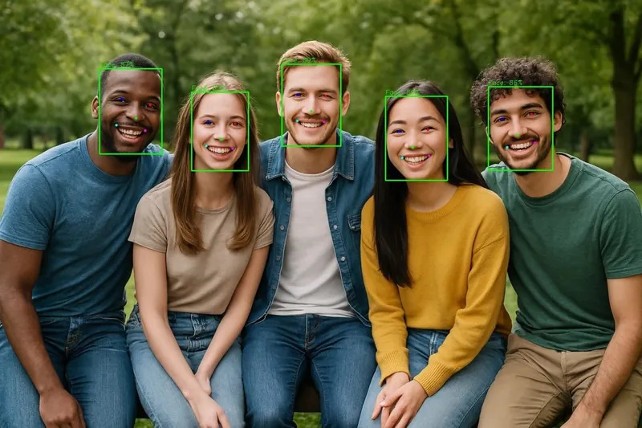

<!-- Generated by DX AI Studio (python -m dx_modelzoo.tools.export_dx_app_cards). Do not edit by hand. -->

# SCRFD-500M

Face Detection · `scrfd-500m_640x640` · DX-APP Python example

Face Detection model, evaluated on WiderFace.

**Input** 640 × 640 × 3 · **Dataset** WiderFace · **License** MIT · **Quantization** Q-Lite, Q-Pro



Full card with copy buttons and dark/light theme (open it in a browser; GitHub shows its source): [model.html](model.html)

## Quick start

Run from the dx_app root after `./install.sh` and `./build.sh`.

```bash
# from the dx_app root
./setup_sample_models.sh --models SCRFD500M
```

**Python**

```bash
python src/python_example/face_detection/scrfd/scrfd-500m_640x640/scrfd-500m_640x640_sync.py \
  --model assets/models/scrfd-500m_640x640.dxnn \
  --image sample/img/sample_face.jpg
```

**C++**

```bash
./build.sh --target scrfd-500m_640x640_sync   # once
./bin/scrfd-500m_640x640_sync \
  -m assets/models/scrfd-500m_640x640.dxnn \
  -i sample/img/sample_face.jpg
```

## Accuracy

| Quantization | AP(Easy) | AP(Med) | AP(Hard) |
|---|---:|---:|---:|
| Raw · ONNX | 91.07 | 88.46 | 69.37 |
| Q-Lite | 90.52 (−0.55) | 88.08 (−0.38) | 69.02 (−0.35) |
| Q-Pro | 90.93 (−0.14) | 88.36 (−0.10) | 68.92 (−0.45) |

WiderFace · difference vs Raw in brackets.

## Model

| | |
|---|---|
| Task | Face Detection |
| Dataset | WiderFace |
| Metric | AP(Easy) · AP(Med) · AP(Hard) |
| Input | 640 × 640 × 3 |
| Parameters | 626.34 M |
| Operations | 764.58 GOPs |
| Family | scrfd |

## Downloads

| Artifact | Compiler | Files |
|---|---|---|
| ONNX | — | [ONNX](https://sdk.deepx.ai/modelzoo/onnx/scrfd-500m_640x640.onnx) |
| Q-Lite | DX-COM 2.5.0 | [DXNN](https://sdk.deepx.ai/modelzoo/q-lite-dxnn/2_5_0/scrfd-500m_640x640.dxnn) · [JSON](https://sdk.deepx.ai/modelzoo/q-lite-json/2_5_0/scrfd-500m_640x640.json) |
| Q-Pro | DX-COM 2.4.0 | [DXNN](https://sdk.deepx.ai/modelzoo/q-pro-dxnn/2_4_0/scrfd-500m_640x640.dxnn) |

## Files in this example

| File | What it is |
|---|---|
| `scrfd-500m_640x640_sync.py` | Python · one image, video or camera |
| `scrfd-500m_640x640_async.py` | Python · pipelined, higher throughput |
| `scrfd-500m_640x640_sync_cpp_postprocess.py` | Python with the C++ postprocess binding |
| `scrfd-500m_640x640_async_cpp_postprocess.py` | Python async with the C++ postprocess binding |
| `config.json` | Thresholds, input size, default sample |
| `factory/` | Pre-, post-processor and visualizer |

[C++ version of this example](../../../../cpp_example/face_detection/scrfd/scrfd-500m_640x640/)

## Source & License

[deepinsight/insightface/tree/master/detection/scrfd](https://github.com/deepinsight/insightface/tree/master/detection/scrfd) — MIT (MIT License — https://opensource.org/license/mit) · © InsightFace. Check the upstream license before commercial use.

Compile it yourself: DX-COM in dx-compiler, or DX AI Studio → Compiler.

---

<sub>Generated from the DX Model Zoo publish table (as of 2026-10-13). Open this model in DX AI Studio → Model Zoo for live inference and the model graph.</sub>
