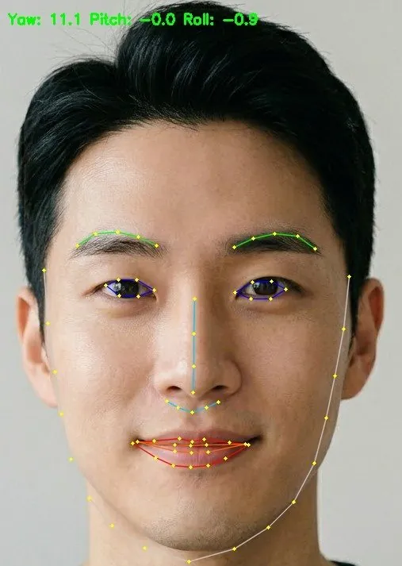

<!-- Generated by DX AI Studio (python -m dx_modelzoo.tools.export_dx_app_cards). Do not edit by hand. -->

# 3DDFA-V2 (MobileNetV1)

Face Alignment · `3ddfa-v2_mobilenetv1_120x120` · DX-APP Python example

Face Alignment model, evaluated on AFLW20003D.

**Input** 120 × 120 × 3 · **Dataset** AFLW20003D · **License** MIT · **Quantization** Q-Lite, Q-Pro



Full card with copy buttons and dark/light theme (open it in a browser; GitHub shows its source): [model.html](model.html)

## Quick start

Run from the dx_app root after `./install.sh` and `./build.sh`.

```bash
# from the dx_app root
./setup_sample_models.sh --models 3ddfa_v2_mobilnetv1_120x120
```

**Python**

```bash
python src/python_example/face_landmark/3ddfa_v2/3ddfa-v2_mobilenetv1_120x120/3ddfa-v2_mobilenetv1_120x120_sync.py \
  --model assets/models/3ddfa-v2_mobilenetv1_120x120.dxnn \
  --image sample/img/sample_face_a1.jpg
```

**C++**

```bash
./build.sh --target 3ddfa-v2_mobilenetv1_120x120_sync   # once
./bin/3ddfa-v2_mobilenetv1_120x120_sync \
  -m assets/models/3ddfa-v2_mobilenetv1_120x120.dxnn \
  -i sample/img/sample_face_a1.jpg
```

## Accuracy

| Quantization | NME |
|---|---:|
| Raw · ONNX | 3.45 |
| Q-Lite | 3.51 (+0.06) |
| Q-Pro | 3.55 (+0.10) |

AFLW20003D · difference vs Raw in brackets.

## Model

| | |
|---|---|
| Task | Face Alignment |
| Dataset | AFLW20003D |
| Metric | NME |
| Input | 120 × 120 × 3 |
| Parameters | 3.29 M |
| Operations | 225.45 GOPs |
| Family | 3ddfa_v2 |

## Downloads

| Artifact | Compiler | Files |
|---|---|---|
| ONNX | — | [ONNX](https://sdk.deepx.ai/modelzoo/onnx/3ddfa-v2_mobilenetv1_120x120.onnx) |
| Q-Lite | DX-COM 2.5.0 | [DXNN](https://sdk.deepx.ai/modelzoo/q-lite-dxnn/2_5_0/3ddfa-v2_mobilenetv1_120x120.dxnn) · [JSON](https://sdk.deepx.ai/modelzoo/q-lite-json/2_5_0/3ddfa-v2_mobilenetv1_120x120.json) |
| Q-Pro | DX-COM 2.4.0 | [DXNN](https://sdk.deepx.ai/modelzoo/q-pro-dxnn/2_4_0/3ddfa-v2_mobilenetv1_120x120.dxnn) |

## Files in this example

| File | What it is |
|---|---|
| `3ddfa-v2_mobilenetv1_120x120_sync.py` | Python · one image, video or camera |
| `3ddfa-v2_mobilenetv1_120x120_async.py` | Python · pipelined, higher throughput |
| `3ddfa-v2_mobilenetv1_120x120_sync_cpp_postprocess.py` | Python with the C++ postprocess binding |
| `3ddfa-v2_mobilenetv1_120x120_async_cpp_postprocess.py` | Python async with the C++ postprocess binding |
| `config.json` | Thresholds, input size, default sample |
| `factory/` | Pre-, post-processor and visualizer |

[C++ version of this example](../../../../cpp_example/face_landmark/3ddfa_v2/3ddfa-v2_mobilenetv1_120x120/)

## Source & License

[cleardusk/3DDFA_V2](https://github.com/cleardusk/3DDFA_V2) — MIT (MIT License — https://opensource.org/license/mit) · © cleardusk. Check the upstream license before commercial use.

Compile it yourself: DX-COM in dx-compiler, or DX AI Studio → Compiler.

---

<sub>Generated from the DX Model Zoo publish table (as of 2026-10-13). Open this model in DX AI Studio → Model Zoo for live inference and the model graph.</sub>
