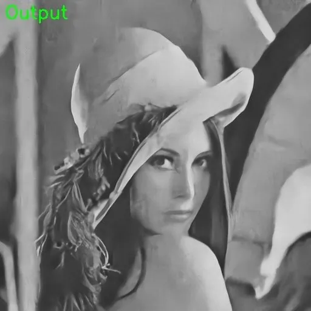

<!-- Generated by DX AI Studio (python -m dx_modelzoo.tools.export_dx_app_cards). Do not edit by hand. -->

# DnCNN-50

Image Denoising · `dncnn-50_512x512` · DX-APP Python example

Image Denoising model, evaluated on BSD68.

**Input** 512 × 512 × 1 · **Dataset** BSD68 · **License** Apache-2.0 · **Quantization** Q-Lite, Q-Pro



Full card with copy buttons and dark/light theme (open it in a browser; GitHub shows its source): [model.html](model.html)

## Quick start

Run from the dx_app root after `./install.sh` and `./build.sh`.

```bash
# from the dx_app root
./setup_sample_models.sh --models DnCNN_50
```

**Python**

```bash
python src/python_example/image_denoising/dncnn/dncnn-50_512x512/dncnn-50_512x512_sync.py \
  --model assets/models/dncnn-50_512x512.dxnn \
  --image sample/img/sample_denoising.jpg
```

**C++**

```bash
./build.sh --target dncnn-50_512x512_sync   # once
./bin/dncnn-50_512x512_sync \
  -m assets/models/dncnn-50_512x512.dxnn \
  -i sample/img/sample_denoising.jpg
```

## Accuracy

| Quantization | PSNR | SSIM |
|---|---:|---:|
| Raw · ONNX | 27.76 | 0.76 |
| Q-Lite | 25.97 (−1.79) | 0.72 (−0.04) |
| Q-Pro | 26.27 (−1.49) | 0.72 (−0.04) |

BSD68 · difference vs Raw in brackets.

## Model

| | |
|---|---|
| Task | Image Denoising |
| Dataset | BSD68 |
| Metric | PSNR · SSIM |
| Input | 512 × 512 × 1 |
| Parameters | 555.14 M |
| Operations | 145.79 GOPs |
| Family | dncnn |

## Downloads

| Artifact | Compiler | Files |
|---|---|---|
| ONNX | — | [ONNX](https://sdk.deepx.ai/modelzoo/onnx/dncnn-50_512x512.onnx) |
| Q-Lite | DX-COM 2.5.0 | [DXNN](https://sdk.deepx.ai/modelzoo/q-lite-dxnn/2_5_0/dncnn-50_512x512.dxnn) · [JSON](https://sdk.deepx.ai/modelzoo/q-lite-json/2_5_0/dncnn-50_512x512.json) |
| Q-Pro | DX-COM 2.4.0 | [DXNN](https://sdk.deepx.ai/modelzoo/q-pro-dxnn/2_4_0/dncnn-50_512x512.dxnn) |

## Files in this example

| File | What it is |
|---|---|
| `dncnn-50_512x512_sync.py` | Python · one image, video or camera |
| `dncnn-50_512x512_async.py` | Python · pipelined, higher throughput |
| `dncnn-50_512x512_sync_cpp_postprocess.py` | Python with the C++ postprocess binding |
| `dncnn-50_512x512_async_cpp_postprocess.py` | Python async with the C++ postprocess binding |
| `config.json` | Thresholds, input size, default sample |
| `factory/` | Pre-, post-processor and visualizer |

[C++ version of this example](../../../../cpp_example/image_denoising/dncnn/dncnn-50_512x512/)

## Source & License

[cszn/DnCNN](https://github.com/cszn/DnCNN) — Apache-2.0 (Apache License 2.0 — https://www.apache.org/licenses/LICENSE-2.0) · © cszn. Check the upstream license before commercial use.

Compile it yourself: DX-COM in dx-compiler, or DX AI Studio → Compiler.

---

<sub>Generated from the DX Model Zoo publish table (as of 2026-10-13). Open this model in DX AI Studio → Model Zoo for live inference and the model graph.</sub>
