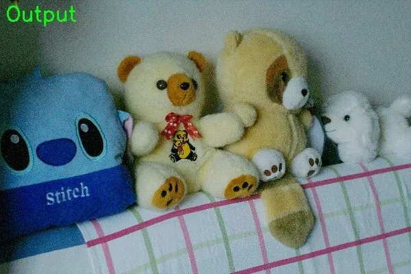

<!-- Generated by DX AI Studio (python -m dx_modelzoo.tools.export_dx_app_cards). Do not edit by hand. -->

# Zero-DCE++

Image Enhancement · `zerodce-pp_400x600` · DX-APP Python example

Image Enhancement model, evaluated on LOL.

**Input** 400 × 600 × 3 · **Dataset** LOL · **License** Non-commercial · **Quantization** Q-Lite, Q-Pro



Full card with copy buttons and dark/light theme (open it in a browser; GitHub shows its source): [model.html](model.html)

## Quick start

Run from the dx_app root after `./install.sh` and `./build.sh`.

```bash
# from the dx_app root
./setup_sample_models.sh --models zero_dce_pp-1
```

**Python**

```bash
python src/python_example/low_light_enhancement/zerodce/zerodce-pp_400x600/zerodce-pp_400x600_sync.py \
  --model assets/models/zerodce-pp_400x600.dxnn \
  --image sample/img/sample_lowlight.jpg
```

**C++**

```bash
./build.sh --target zerodce-pp_400x600_sync   # once
./bin/zerodce-pp_400x600_sync \
  -m assets/models/zerodce-pp_400x600.dxnn \
  -i sample/img/sample_lowlight.jpg
```

## Accuracy

| Quantization | PSNR | SSIM |
|---|---:|---:|
| Raw · ONNX | 15.18 | 0.49 |
| Q-Lite | 15.17 (−0.01) | 0.49 (±0.00) |
| Q-Pro | 15.00 (−0.18) | 0.45 (−0.04) |

LOL · difference vs Raw in brackets.

## Model

| | |
|---|---|
| Task | Image Enhancement |
| Dataset | LOL |
| Metric | PSNR · SSIM |
| Input | 400 × 600 × 3 |
| Parameters | 10.56 M |
| Operations | 2.84 GOPs |
| Family | zerodce |

## Downloads

| Artifact | Compiler | Files |
|---|---|---|
| ONNX | — | [ONNX](https://sdk.deepx.ai/modelzoo/onnx/zerodce-pp_400x600.onnx) |
| Q-Lite | DX-COM 2.5.0 | [DXNN](https://sdk.deepx.ai/modelzoo/q-lite-dxnn/2_5_0/zerodce-pp_400x600.dxnn) · [JSON](https://sdk.deepx.ai/modelzoo/q-lite-json/2_5_0/zerodce-pp_400x600.json) |
| Q-Pro | DX-COM 2.4.0 | [DXNN](https://sdk.deepx.ai/modelzoo/q-pro-dxnn/2_4_0/zerodce-pp_400x600.dxnn) |

## Files in this example

| File | What it is |
|---|---|
| `zerodce-pp_400x600_sync.py` | Python · one image, video or camera |
| `zerodce-pp_400x600_async.py` | Python · pipelined, higher throughput |
| `zerodce-pp_400x600_sync_cpp_postprocess.py` | Python with the C++ postprocess binding |
| `zerodce-pp_400x600_async_cpp_postprocess.py` | Python async with the C++ postprocess binding |
| `config.json` | Thresholds, input size, default sample |
| `factory/` | Pre-, post-processor and visualizer |

[C++ version of this example](../../../../cpp_example/low_light_enhancement/zerodce/zerodce-pp_400x600/)

## Source & License

[Li-Chongyi/Zero-DCE_extension](https://github.com/Li-Chongyi/Zero-DCE_extension) — Non-commercial (Non-commercial use only — see the source repository for terms) · © Li-Chongyi. Check the upstream license before commercial use.

Compile it yourself: DX-COM in dx-compiler, or DX AI Studio → Compiler.

---

<sub>Generated from the DX Model Zoo publish table (as of 2026-10-13). Open this model in DX AI Studio → Model Zoo for live inference and the model graph.</sub>
