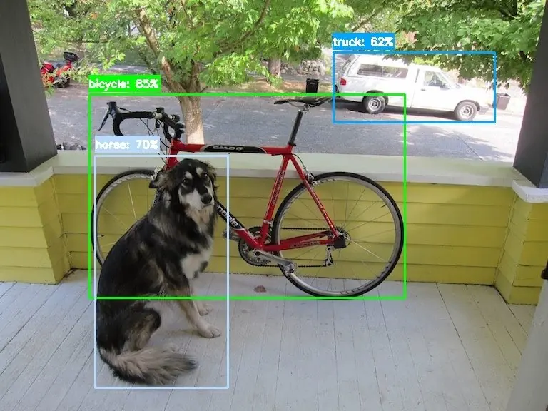

<!-- Generated by DX AI Studio (python -m dx_modelzoo.tools.export_dx_app_cards). Do not edit by hand. -->

# EfficientDet-D2

Object Detection · `efficientdet-d2_768x768` · DX-APP Python example

Object Detection model, evaluated on COCO.

**Input** 768 × 768 × 3 · **Dataset** COCO · **License** Apache-2.0 · **Quantization** Q-Lite, Q-Pro



Full card with copy buttons and dark/light theme (open it in a browser; GitHub shows its source): [model.html](model.html)

## Quick start

Run from the dx_app root after `./install.sh` and `./build.sh`.

```bash
# from the dx_app root
./setup_sample_models.sh --models EfficientDetD2
```

**Python**

```bash
python src/python_example/object_detection/efficientdet/efficientdet-d2_768x768/efficientdet-d2_768x768_sync.py \
  --model assets/models/efficientdet-d2_768x768.dxnn \
  --image sample/img/sample_street.jpg
```

**C++**

```bash
./build.sh --target efficientdet-d2_768x768_sync   # once
./bin/efficientdet-d2_768x768_sync \
  -m assets/models/efficientdet-d2_768x768.dxnn \
  -i sample/img/sample_street.jpg
```

## Accuracy

| Quantization | mAP |
|---|---:|
| Raw · ONNX | 41.93 |
| Q-Lite | 40.61 (−1.32) |
| Q-Pro | 31.70 (−10.23) |

COCO · difference vs Raw in brackets.

> **Note:** Q-Pro is 10.23 points below Raw on mAP.

## Model

| | |
|---|---|
| Task | Object Detection |
| Dataset | COCO |
| Metric | mAP |
| Input | 768 × 768 × 3 |
| Parameters | 8.35 M |
| Operations | 15.38 GOPs |
| Family | efficientdet |

## Downloads

| Artifact | Compiler | Files |
|---|---|---|
| ONNX | — | [ONNX](https://sdk.deepx.ai/modelzoo/onnx/efficientdet-d2_768x768.onnx) |
| Q-Lite | DX-COM 2.5.0 | [DXNN](https://sdk.deepx.ai/modelzoo/q-lite-dxnn/2_5_0/efficientdet-d2_768x768.dxnn) · [JSON](https://sdk.deepx.ai/modelzoo/q-lite-json/2_5_0/efficientdet-d2_768x768.json) |
| Q-Pro | DX-COM 2.4.0 | [DXNN](https://sdk.deepx.ai/modelzoo/q-pro-dxnn/2_4_0/efficientdet-d2_768x768.dxnn) |

## Files in this example

| File | What it is |
|---|---|
| `efficientdet-d2_768x768_sync.py` | Python · one image, video or camera |
| `efficientdet-d2_768x768_async.py` | Python · pipelined, higher throughput |
| `efficientdet-d2_768x768_sync_cpp_postprocess.py` | Python with the C++ postprocess binding |
| `efficientdet-d2_768x768_async_cpp_postprocess.py` | Python async with the C++ postprocess binding |
| `config.json` | Thresholds, input size, default sample |
| `factory/` | Pre-, post-processor and visualizer |

[C++ version of this example](../../../../cpp_example/object_detection/efficientdet/efficientdet-d2_768x768/)

## Source & License

[google/automl/tree/master/efficientdet](https://github.com/google/automl/tree/master/efficientdet) — Apache-2.0 (Apache License 2.0 — https://www.apache.org/licenses/LICENSE-2.0) · © Google. Check the upstream license before commercial use.

Compile it yourself: DX-COM in dx-compiler, or DX AI Studio → Compiler.

---

<sub>Generated from the DX Model Zoo publish table (as of 2026-10-13). Open this model in DX AI Studio → Model Zoo for live inference and the model graph.</sub>
