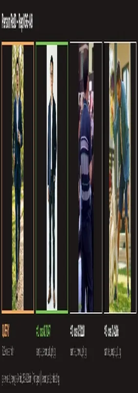

<!-- Generated by DX AI Studio (python -m dx_modelzoo.tools.export_dx_app_cards). Do not edit by hand. -->

# RepVGG-A0 Person ReID

Re-Identification · `repvgg-a0-reid_256x128` · DX-APP Python example

Re-Identification model, evaluated on Market1501.

**Input** 256 × 128 × 3 · **Dataset** Market1501 · **License** MIT · **Quantization** Q-Lite



Full card with copy buttons and dark/light theme (open it in a browser; GitHub shows its source): [model.html](model.html)

## Quick start

Run from the dx_app root after `./install.sh` and `./build.sh`.

```bash
# from the dx_app root
./setup_sample_models.sh --models repvgg_a0_reid_256x128
```

**Python**

```bash
python src/python_example/person_reid/repvgg_reid/repvgg-a0-reid_256x128/repvgg-a0-reid_256x128_sync.py \
  --model assets/models/repvgg-a0-reid_256x128.dxnn \
  --image sample/reid/queries/sample_person_a2.jpg
```

**C++**

```bash
./build.sh --target repvgg-a0-reid_256x128_sync   # once
./bin/repvgg-a0-reid_256x128_sync \
  -m assets/models/repvgg-a0-reid_256x128.dxnn \
  -i sample/reid/queries/sample_person_a2.jpg
```

## Accuracy

| Quantization | Rank-1 | mAP |
|---|---:|---:|
| Raw · ONNX | 80.64 | 59.12 |
| Q-Lite | 76.31 (−4.33) | 52.98 (−6.14) |

Market1501 · difference vs Raw in brackets.

> **Note:** Q-Lite is 6.14 points below Raw on mAP.

## Model

| | |
|---|---|
| Task | Re-Identification |
| Dataset | Market1501 |
| Metric | Rank-1 · mAP |
| Input | 256 × 128 × 3 |
| Parameters | 7.68 M |
| Operations | 0.89 GOPs |
| Family | repvgg_reid |

## Downloads

| Artifact | Compiler | Files |
|---|---|---|
| ONNX | — | [ONNX](https://sdk.deepx.ai/modelzoo/onnx/repvgg-a0-reid_256x128.onnx) |
| Q-Lite | DX-COM 2.5.0 | [DXNN](https://sdk.deepx.ai/modelzoo/q-lite-dxnn/2_5_0/repvgg-a0-reid_256x128.dxnn) · [JSON](https://sdk.deepx.ai/modelzoo/q-lite-json/2_5_0/repvgg-a0-reid_256x128.json) |

## Files in this example

| File | What it is |
|---|---|
| `repvgg-a0-reid_256x128_sync.py` | Python · one image, video or camera |
| `repvgg-a0-reid_256x128_async.py` | Python · pipelined, higher throughput |
| `repvgg-a0-reid_256x128_sync_cpp_postprocess.py` | Python with the C++ postprocess binding |
| `repvgg-a0-reid_256x128_async_cpp_postprocess.py` | Python async with the C++ postprocess binding |
| `config.json` | Thresholds, input size, default sample |
| `factory/` | Pre-, post-processor and visualizer |

[C++ version of this example](../../../../cpp_example/person_reid/repvgg_reid/repvgg-a0-reid_256x128/)

## Source & License

[DingXiaoH/RepVGG](https://github.com/DingXiaoH/RepVGG) — MIT (MIT License — https://opensource.org/license/mit) · © DingXiaoH. Check the upstream license before commercial use.

Compile it yourself: DX-COM in dx-compiler, or DX AI Studio → Compiler.

---

<sub>Generated from the DX Model Zoo publish table (as of 2026-10-13). Open this model in DX AI Studio → Model Zoo for live inference and the model graph.</sub>
