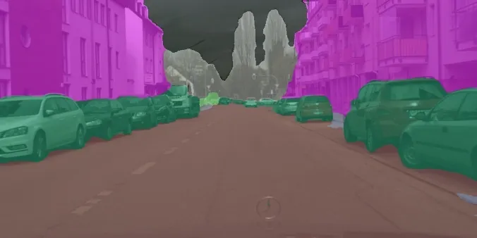

<!-- Generated by DX AI Studio (python -m dx_modelzoo.tools.export_dx_app_cards). Do not edit by hand. -->

# pp_liteseg_stdc1_camvid_960x720_10k

Semantic Segmentation · `pp-liteseg-stdc1-camvid-10k_960x720` · DX-APP Python example

Semantic Segmentation model, evaluated on CamVid.

**Input** 720 × 960 × 3 · **Dataset** CamVid · **License** Apache-2.0 · **Quantization** Q-Lite



Full card with copy buttons and dark/light theme (open it in a browser; GitHub shows its source): [model.html](model.html)

## Quick start

Run from the dx_app root after `./install.sh` and `./build.sh`.

```bash
# from the dx_app root
./setup_sample_models.sh --models pp_liteseg_stdc1_camvid_10k_960x720
```

**Python**

```bash
python src/python_example/semantic_segmentation/pp_liteseg/pp-liteseg-stdc1-camvid-10k_960x720/pp-liteseg-stdc1-camvid-10k_960x720_sync.py \
  --model assets/models/pp-liteseg-stdc1-camvid-10k_960x720.dxnn \
  --image sample/img/sample_parking.jpg
```

**C++**

```bash
./build.sh --target pp-liteseg-stdc1-camvid-10k_960x720_sync   # once
./bin/pp-liteseg-stdc1-camvid-10k_960x720_sync \
  -m assets/models/pp-liteseg-stdc1-camvid-10k_960x720.dxnn \
  -i sample/img/sample_parking.jpg
```

## Accuracy

| Quantization | mIoU |
|---|---:|
| Q-Lite | 63.40 |

## Model

| | |
|---|---|
| Task | Semantic Segmentation |
| Dataset | CamVid |
| Metric | mIoU |
| Input | 720 × 960 × 3 |
| Parameters | 8.04 M |
| Operations | 16.16 GOPs |
| Family | pp_liteseg |

## Downloads

| Artifact | Compiler | Files |
|---|---|---|
| ONNX | — | [ONNX](https://sdk.deepx.ai/modelzoo/onnx/pp-liteseg-stdc1-camvid-10k_960x720.onnx) |
| Q-Lite | DX-COM 2.5.0 | [DXNN](https://sdk.deepx.ai/modelzoo/q-lite-dxnn/2_5_0/pp-liteseg-stdc1-camvid-10k_960x720.dxnn) · [JSON](https://sdk.deepx.ai/modelzoo/q-lite-json/2_5_0/pp-liteseg-stdc1-camvid-10k_960x720.json) |

## Files in this example

| File | What it is |
|---|---|
| `pp-liteseg-stdc1-camvid-10k_960x720_sync.py` | Python · one image, video or camera |
| `pp-liteseg-stdc1-camvid-10k_960x720_async.py` | Python · pipelined, higher throughput |
| `pp-liteseg-stdc1-camvid-10k_960x720_sync_cpp_postprocess.py` | Python with the C++ postprocess binding |
| `pp-liteseg-stdc1-camvid-10k_960x720_async_cpp_postprocess.py` | Python async with the C++ postprocess binding |
| `config.json` | Thresholds, input size, default sample |
| `factory/` | Pre-, post-processor and visualizer |

[C++ version of this example](../../../../cpp_example/semantic_segmentation/pp_liteseg/pp-liteseg-stdc1-camvid-10k_960x720/)

## Source & License

[PaddlePaddle/PaddleSeg/blob/release/2.8/configs/pp_liteseg/pp_liteseg_stdc1_camvid_960x720_10k.yml](https://github.com/PaddlePaddle/PaddleSeg/blob/release/2.8/configs/pp_liteseg/pp_liteseg_stdc1_camvid_960x720_10k.yml) — Apache-2.0 (Apache License 2.0 — https://www.apache.org/licenses/LICENSE-2.0) · © PaddlePaddle. Check the upstream license before commercial use.

Compile it yourself: DX-COM in dx-compiler, or DX AI Studio → Compiler.

---

<sub>Generated from the DX Model Zoo publish table (as of 2026-10-13). Open this model in DX AI Studio → Model Zoo for live inference and the model graph.</sub>
