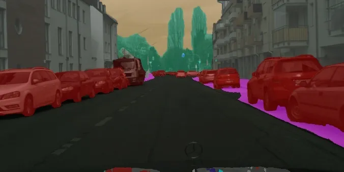

<!-- Generated by DX AI Studio (python -m dx_modelzoo.tools.export_dx_app_cards). Do not edit by hand. -->

# STDC2-Seg75

Semantic Segmentation · `stdc2-seg75_768x1536` · DX-APP Python example

Semantic Segmentation model, evaluated on Cityscapes.

**Input** 768 × 1536 × 3 · **Dataset** Cityscapes · **License** MIT · **Quantization** Q-Lite



Full card with copy buttons and dark/light theme (open it in a browser; GitHub shows its source): [model.html](model.html)

## Quick start

Run from the dx_app root after `./install.sh` and `./build.sh`.

```bash
# from the dx_app root
./setup_sample_models.sh --models stdc2_seg75_768x1536
```

**Python**

```bash
python src/python_example/semantic_segmentation/stdc_seg/stdc2-seg75_768x1536/stdc2-seg75_768x1536_sync.py \
  --model assets/models/stdc2-seg75_768x1536.dxnn \
  --image sample/img/sample_parking.jpg
```

**C++**

```bash
./build.sh --target stdc2-seg75_768x1536_sync   # once
./bin/stdc2-seg75_768x1536_sync \
  -m assets/models/stdc2-seg75_768x1536.dxnn \
  -i sample/img/sample_parking.jpg
```

## Accuracy

| Quantization | mIoU |
|---|---:|
| Raw · ONNX | 77.04 |
| Q-Lite | 75.47 (−1.57) |

Cityscapes · difference vs Raw in brackets.

## Model

| | |
|---|---|
| Task | Semantic Segmentation |
| Dataset | Cityscapes |
| Metric | mIoU |
| Input | 768 × 1536 × 3 |
| Parameters | 12.45 M |
| Operations | 54.98 GOPs |
| Family | stdc_seg |

## Downloads

| Artifact | Compiler | Files |
|---|---|---|
| ONNX | — | [ONNX](https://sdk.deepx.ai/modelzoo/onnx/stdc2-seg75_768x1536.onnx) |
| Q-Lite | DX-COM 2.5.0 | [DXNN](https://sdk.deepx.ai/modelzoo/q-lite-dxnn/2_5_0/stdc2-seg75_768x1536.dxnn) · [JSON](https://sdk.deepx.ai/modelzoo/q-lite-json/2_5_0/stdc2-seg75_768x1536.json) |

## Files in this example

| File | What it is |
|---|---|
| `stdc2-seg75_768x1536_sync.py` | Python · one image, video or camera |
| `stdc2-seg75_768x1536_async.py` | Python · pipelined, higher throughput |
| `stdc2-seg75_768x1536_sync_cpp_postprocess.py` | Python with the C++ postprocess binding |
| `stdc2-seg75_768x1536_async_cpp_postprocess.py` | Python async with the C++ postprocess binding |
| `config.json` | Thresholds, input size, default sample |
| `factory/` | Pre-, post-processor and visualizer |

[C++ version of this example](../../../../cpp_example/semantic_segmentation/stdc_seg/stdc2-seg75_768x1536/)

## Source & License

[MichaelFan01/STDC-Seg](https://github.com/MichaelFan01/STDC-Seg) — MIT (MIT License — https://opensource.org/license/mit) · © MichaelFan01. Check the upstream license before commercial use.

Compile it yourself: DX-COM in dx-compiler, or DX AI Studio → Compiler.

---

<sub>Generated from the DX Model Zoo publish table (as of 2026-10-13). Open this model in DX AI Studio → Model Zoo for live inference and the model graph.</sub>
